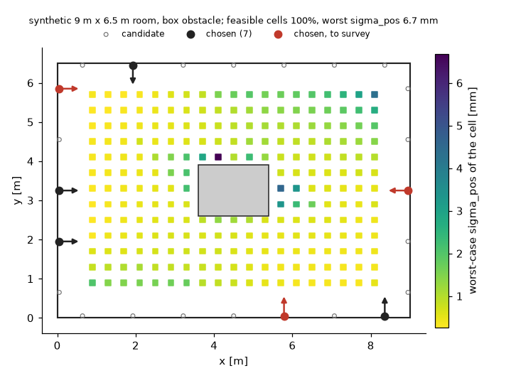
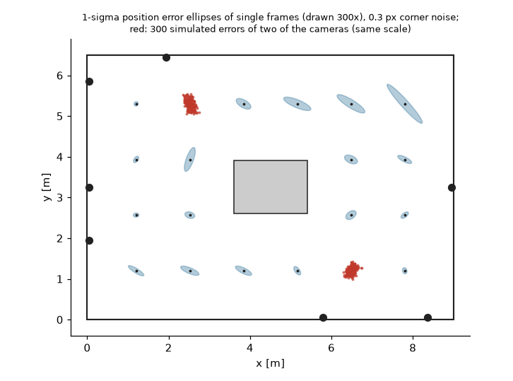

# erploc

Finds where a 360 degree camera is, from the flat square markers (ArUco-style tags) it sees, and works out where to put those markers
in the first place. Rust library (no dependencies), Python bindings, command-line tool. It takes marker corners in an equirectangular
image from a detector such as [eqar](https://github.com/yukis-git/eqar) and returns the camera position and heading with a covariance;
it builds a marker map from a handful of surveyed markers; and it predicts the accuracy a marker layout gives and searches for a small layout
that meets a target everywhere in a workspace.



*A made-up 9 m x 6.5 m room with a box (`docs/make_figures.py`, synthetic data only). Squares: the worst-case position error sigma_pos
of a camera at that cell, over 8 headings, given the markers chosen by `place_markers`; red: the three markers to survey.*



*The same layout. Blue: 1-sigma position error ellipses predicted for cameras at several places (drawn 300 times larger); red: simulated
errors of two of them. Synthetic.*

## Terms used here

- **ERP** (equirectangular projection): a 360 degree image of width `W` and height `H = W / 2`. Column `u` is the longitude `lam` and row `v`
  the latitude `phi` of the viewing ray: `lam = lam_sign * 2*pi/W * (u - (W-1)/2)`, `phi = -2*pi/W * (v - (H-1)/2)`. Pixel *centres* are
  integers (`u` runs from -0.5 to W - 0.5), the same convention as eqar's `corners`. The ray in the camera body frame is
  `(cos phi cos lam, cos phi sin lam, sin phi)`: x forward, y left, z up. For an image whose columns grow to the right and in which a
  marker is not mirrored, that frame needs `lam_sign = -1`; `+1` is the other direction.
- **Marker pose**: position `p` (3,) and a rotation `R` (3, 3) whose columns are the marker's x axis (right as seen from the front), y axis
  (up) and normal (towards the viewer). The marker is a square of side `a` (the printed tag including its black border); its corners are, in
  this order, top-left, top-right, bottom-right, bottom-left, at `p + R (+-a/2, +-a/2, 0)`.
- **Resection**: estimating the camera pose from one frame given the marker poses. `dof="yaw"` estimates position (x, y, z) and yaw and
  takes roll and pitch as known (4 unknowns, the usual case with a levelled camera); `dof="full"` estimates all six.
- **Bundle adjustment**: estimating camera poses of many frames *and* the marker poses together. The gauge (where the origin is, how the map is
  turned) is fixed by a few **surveyed** markers whose positions you measured with a total station or similar, each with its survey
  standard deviation `sigma_ts`.
- **sigma_pos**: the position standard deviation `sqrt(trace(Cov[:3, :3]))` in metres. For a layout it is the Cramer-Rao value from the Fisher
  information of the visible markers, in the worst of the camera headings.
- **Feasible cell**: a place in the workspace where a camera has `sigma_pos <= tau`, sees at least `k_min` markers, and still has
  `sigma_pos <= tau_loo` after any one visible marker is removed (so that one failed detection does not break localisation).
- **IFT**: the minimal-count search of this library. It starts from a greedy layout and improves it with best-improvement tabu phases over
  swaps, for a count `k` = 1, 2, ..., until no cell is infeasible. The name is the library's; it is not expanded here.

## Install

Releases are published as GitHub Release assets only (nothing is on PyPI or crates.io).

**Python** (3.9 or newer; one `abi3` wheel per platform: Linux x86_64 / aarch64, macOS arm64 / x86_64, Windows x64). Install numpy first,
because `--no-index` keeps pip from fetching it:

```sh
pip install numpy
pip install erploc --no-index --find-links https://github.com/yukis-git/erploc/releases/expanded_assets/v0.1.0
```

A checkout installs with `pip install .` (needs a Rust toolchain; uses maturin). eqar is optional and only the examples use it.

**Command line**: the release has `erploc-<tag>-linux-x86_64.tar.gz`, `-macos-arm64.tar.gz` and `-windows-x64.zip` with the `erploc` binary,
and `SHA256SUMS`. Or `cargo build --release -p erploc-cli`.

**Rust** (1.80.1 or newer):

```toml
[dependencies]
erploc-est = { git = "https://github.com/yukis-git/erploc", tag = "v0.1.0" }
erploc-place = { git = "https://github.com/yukis-git/erploc", tag = "v0.1.0" }
```

Crates: `erploc-linalg` (small dense linear algebra), `erploc-core` (projection, poses, Jacobians), `erploc-est` (resection, bundle adjustment,
Fisher information), `erploc-place` (visibility, placement, site model), `erploc-cli`, `erploc-testkit` (tests only), `erploc-py` (not a
library). The four library crates have no dependencies and forbid `unsafe`.

## Quick start (Python)

```python
import numpy as np
import erploc

# 1. where to put markers in a made-up 8 m x 6 m room
room = [[0, 0], [8, 0], [8, 6], [0, 6]]
camera = erploc.Camera(6528, lam_sign=-1)
candidates = erploc.wall_candidates(room, 1.5, z=1.5)            # rows x, y, z, azimuth
scene = erploc.Scene([[0.8, 0.8], [7.2, 0.8], [7.2, 5.2], [0.8, 5.2]], candidates, camera=camera, a=0.20, z_cam=[1.2])
plan = erploc.place_markers(scene, tau=0.02, k_min=3)
print(plan.count, plan.feasible_fraction, round(plan.worst_sigma_pos * 1000, 1), "mm")
# 5 1.0 2.1 mm

# 2. localise a camera from the corners it sees (here predicted; with a real camera they come from a detector).
#    predict_corners has no visibility test; in this layout all five markers face the camera position.
markers = {int(j): erploc.upright_marker(c[:3], c[3]) for j, c in zip(plan.chosen, plan.chosen_candidates)}
truth = erploc.Pose([3.3, 2.1, 1.2], yaw=0.7)
rng = np.random.default_rng(0)
obs = [erploc.Observation(i, px + rng.normal(0, 0.1, (4, 2))) for i, px in erploc.predict_corners(truth, markers, camera, 0.20).items()]
fit = erploc.resection(obs, markers, camera, 0.20, sigma_px=0.1)
print(np.round(fit.position, 4), round(fit.yaw, 4), round(fit.sigma_pos * 1000, 2), "mm")
# [3.3    2.0998 1.2001] 0.7 0.2 mm
```

With eqar, the detections go in directly (an `eqar.Marker` has `id`, `corners`, `corner_valid`, `corner_sigma_scale`):

```python
import eqar
obs = erploc.observations_from_eqar(eqar.detect(img, "4x4_50", format="gray"))   # img: uint8 (H, 2H)
fit = erploc.resection(obs, markers, camera, a=0.20)                          # markers: {id: (position, rotation)}
```

`observations_from_eqar` works by duck typing (objects with those attributes, or the dicts of `Marker.to_dict()`); erploc does not import
eqar. The per-corner validity and sigma scale are kept and used by `resection` and `bundle_adjust`: an invalid corner contributes no
residual and its pixel value is never read, and a larger scale weights that corner less. Entries with `ok == False` or a negative id are skipped.

`examples/end_to_end.py` runs the whole chain on a synthetic room, including rendering frames and detecting with eqar (output below).

## Quick start (Rust)

`crates/erploc-place/examples/quickstart.rs` (`cargo run --release -p erploc-place --example quickstart`). In your own crate, depend on the
four crates the code uses (until a release on crates.io, from git; they have no further dependencies):

```toml
[dependencies]
erploc-core = { git = "https://github.com/yukis-git/erploc" }
erploc-linalg = { git = "https://github.com/yukis-git/erploc" }
erploc-est = { git = "https://github.com/yukis-git/erploc" }
erploc-place = { git = "https://github.com/yukis-git/erploc" }
```

```rust
use erploc_core::jacobian::CamPose;
use erploc_est::lm::Loss;
use erploc_est::resection::{resect, CamDof, ResectOptions};
use erploc_est::synth::{add_noise, render, SynthConfig};
use erploc_linalg::rng::Pcg64;
use erploc_place::placement::{demo_spec, markers_from_candidates, optimize};
use std::collections::BTreeMap;

fn main() -> Result<(), Box<dyn std::error::Error>> {
    let spec = demo_spec(10);                               // 8 m x 6 m room, a box, 16 wall candidates, at most 10 markers
    let plan = optimize(&spec, 0.005)?;                     // greedy + 1-swap + prune + survey triplet (sigma_ts = 5 mm)
    let all = markers_from_candidates(&spec.candidates);
    let chosen: Vec<_> = plan.sel.iter().map(|&j| all[j]).collect();
    let map: BTreeMap<_, _> = chosen.iter().map(|m| (m.id, *m)).collect();
    let truth = CamPose::euler([2.0, 1.5, 1.2], 0.8, 0.0, 0.0);
    let cfg = SynthConfig { cam: spec.cam_model, a: spec.a, sigma_px: spec.sigma_px, noise_model: spec.noise_model, seed: 1 };
    let noisy = add_noise(&render(&[truth], &chosen, &cfg, None), &cfg, &mut Pcg64::new(1));
    let opts = ResectOptions { x0: None, sigma_px: spec.sigma_px, noise_model: spec.noise_model, loss: Loss::Linear, dof: CamDof::Yaw };
    let fit = resect(&noisy[0], &map, spec.a, &spec.cam_model, 0.0, 0.0, &opts)?;
    println!("{} markers, position {:?}", fit.n_markers, fit.cam.c);
    Ok(())
}
```

The example program, which prints a little more, gives:

```
chosen candidates [6, 5, 1, 0], survey [6, 5, 0], infeasible cells 0 of 88
4 markers seen, position error 0.33 mm, yaw error 0.0017 deg
```

## Command line

```
erploc place  --in spec.json [--out result.json] [--csv report.csv] [--method greedy|ift] [--budget-ms N] [--sigma-ts 0.005]
erploc resect --in obs.json [--out result.json]
erploc ba     --in problem.json [--out result.json]
erploc site   --tables site.bin --in query.json [--out result.json]
erploc e2e    [--seed-base N] [--budget-s S]
```

JSON in, JSON out; `--in -` reads standard input. Angles are radians, rotations row-major. Synthetic example inputs, generated by
`examples/make_cli_inputs.py`, are in `examples/cli/`:

```sh
erploc resect --in examples/cli/resect.json      # pose, covariance, information, rms
erploc ba     --in examples/cli/ba.json          # cameras, markers, covariances
erploc place  --in examples/cli/place.json --csv layout.csv
cargo run --release -p erploc-place --example gen_site -- site.bin       # a fully synthetic site table (docs/site-tables.md)
erploc site   --tables site.bin --in examples/cli/site_query.json
```

Exit codes: 0 ok, 1 an `e2e` check failed, 2 usage, 3 invalid input, 4 numerical failure, 5 i/o error, 70 internal error (a bug). The format of
site tables (`ERPSITE1`) is in `docs/site-tables.md`; you can write one with your own geometry code. `erploc e2e` runs the research code's
end-to-end checks on a built-in demo room; see the limits.

## Python API

Arrays are numpy arrays, lists work as inputs. Invalid input raises `ValueError` (`TypeError` for the wrong kind of object; `OverflowError` for an integer argument that is negative where
the parameter is unsigned, such as `Camera(-1)`, or too large for 64 bits); a computation that
fails numerically raises `erploc.NumericalError` (a `RuntimeError`). Nothing panics; computation runs without the GIL. Type stubs are included.

| | |
|---|---|
| `Camera(width, height=None, lam_sign=1)` | ERP camera; `width == 2 * height` |
| `Pose(position, yaw=0, roll=0, pitch=0, rotation=None)` | camera pose; `R = Rz(yaw) Ry(pitch) Rx(roll)`, camera to world |
| `Observation(id, corners, corner_valid=None, corner_sigma_scale=None)` | one detected marker, `corners` (4, 2) pixels TL, TR, BR, BL |
| `observations_from_eqar(markers)` | eqar markers (or dicts) to `Observation`s |
| `resection(observations, markers, camera, a, *, sigma_px=0.3, noise_model="tangent", loss="linear", huber_delta=1.5, dof="yaw", roll=0, pitch=0, x0=None)` | `Resection`: `pose`, `position`, `yaw`, `cov`, `info`, `sigma_pos`, `rms_px`, `n_markers`, `converged` |
| `bundle_adjust(frames, camera, a, survey_markers, *, rp=None, sigma_px, noise_model, dof, loss, huber_delta, max_iter=50, x0=None)` | `Bundle`: `cameras`, `markers`, `cov_markers`, `cov_cams`, `info`, `cov`, `rms_px`, `null_dim`, `state` |
| `init_bundle(frames, camera, a, survey_markers, *, rp=None, ..., refine_rounds=1)` | `BundleState` start values (also the default start of `bundle_adjust`) |
| `fisher_camera(pose, markers, camera, a, *, sigma_px, noise_model, dof)`, `sigma_pos(info)` | Fisher information of a camera given the markers it sees; its sigma_pos |
| `predict_corners(pose, markers, camera, a)` | noise-free corner pixels, no visibility test |
| `Scene(workspace, candidates, obstacles=None, *, camera, a, sigma_px, noise_model, psi_max_deg=70, px_min=12, eps, sectors, spacing=0.5, z_cam, headings)` | placement problem: workspace polygon (n, 2), candidates (m, 4) `x y z azimuth`, obstacles `[(polygon, height)]` |
| `place_markers(scene, tau, *, k_min=2, n_max=None, tau_loo=None, sigma_cap=10, w_k=1, method="greedy"/"ift", budget_ms=None, sigma_ts=0.005)` | `Placement`: `chosen`, `survey_ids`, `count`, `feasible_fraction`, `worst_sigma_pos`, per-cell `sigma`, `n_vis`, `sigma_loo`, `feasible`, `margin`, `cells` |
| `evaluate(scene, chosen, tau, ...)` | the same `Placement` for a layout you give |
| `wall_candidates(polygon, spacing, *, z, offset, inward)`, `upright_marker(position, azimuth)` | candidates along the walls; the pose of a candidate |

`markers` and `survey_markers` are dicts: `{id: (position, rotation)}` and `{id: (position, sigma_ts)}`. `noise_model` is `"tangent"` (corner noise
of `sigma_px` pixels on the tangent plane of the viewing ray, so the longitude noise grows as 1 / cos(phi)) or `"pixel"` (isotropic in the image).
`sigma_pos` of a `Placement` cell is capped at `sigma_cap` (10 m), which is what a cell with fewer than one visible marker gets.

## End-to-end example

`examples/end_to_end.py` places markers in a made-up 8 m x 6 m room, renders equirectangular frames of the chosen tags with numpy (each frame:
inverse mapping of every pixel onto the marker planes, 3 x 3 supersampling, Gaussian blur with sd 0.8 px, noise sd 3 grey levels,
`eqar.generate_marker` for the tag patterns), detects them with eqar, then runs `resection` per frame and `bundle_adjust` with three surveyed
markers, and compares with the known truth. The render has no lens model, no stitching seam and no exposure effects: the errors below are
those of an idealised setup and are not a prediction for a real camera.

```sh
pip install numpy
pip install eqar --no-index --find-links https://github.com/yukis-git/eqar/releases/expanded_assets/v0.1.0
python examples/end_to_end.py
```

Real output (Apple M4, erploc 0.1.0, eqar 0.1.0, Python 3.12):

```
erploc 0.1.0, eqar 0.1.0
placement: 5 of 18 candidates, feasible cells 100% of 117, worst sigma_pos 1.0 mm, survey ids [15, 6, 14] (1.4 s)
7 frames of 6528x3264: markers detected per frame [5, 5, 5, 5, 5, 5, 5] (facing the camera: [5, 5, 5, 5, 5, 5, 5]); render 0.34 s, eqar.detect 8 ms per frame

resection (marker map known):
  frame  markers  position error [mm]  predicted sigma_pos [mm]  yaw error [deg]  rms residual [px]
      0        5                 0.81                      0.38           0.0064              0.087
      1        5                 0.78                      0.35           0.0018              0.051
      2        5                 0.23                      0.25           0.0022              0.068
      3        5                 0.14                      0.19           0.0007              0.086
      4        5                 0.10                      0.18           0.0000              0.068
      5        5                 0.26                      0.21           0.0029              0.066
      6        5                 0.08                      0.15           0.0003              0.063
  median position error 0.23 mm, max 0.81 mm

bundle adjustment: 7 frames, 5 markers, 3 surveyed (survey error 3.5 mm mean), converged=True, rms 0.066 px
  camera position error: median 3.23 mm, max 3.27 mm
  unsurveyed marker position error: median 3.41 mm, max 3.69 mm (predicted sigma: median 5.64 mm)
```

## Benchmarks

`bench/bench.py` (about 6 minutes; `bench/RESULTS.md` has the full output with machine, load and conditions). Measured on an Apple M4 that was
shared with other work (1-minute load average about 3 at the start); single thread, release build:

| operation (8 m x 6 m room, 14 markers, 4096 px frames) | median |
|---|---|
| `resection`, 4 dof / 6 dof | 0.13 ms / 0.18 ms |
| `bundle_adjust` with 10 frames / 40 frames (including the initialisation) | 60 ms / 363 ms |
| `place_markers`, small synthetic room (12 candidates, 50 cells), greedy / IFT | 106 ms / 25 ms |
| `place_markers`, larger synthetic room (16 candidates, 88 cells), greedy / IFT | 551 ms / 52 ms |

Placement quality on 24 small and 8 larger random synthetic rooms (tau 30 mm, `k_min` 2, `tau_loo` 100 mm): on the 24 small rooms (10 to 14
candidates) the IFT count equals the exhaustive-enumeration minimum in all 24, greedy in 19; on the 8 larger rooms (20 to 24 candidates) IFT used
42 markers in total against 47 for greedy and 47 for the smallest random layouts found in 200 draws per count. Equally many random markers were
feasible on 89 % of the cells on average, evenly spaced ones on 93 % (small rooms) to 96 % (larger rooms). The worst-case sigma_pos of the IFT
layout was up to 4.11 times that of the best layout of the same size (median 1.17). These are results on synthetic rooms with the model's own
notion of feasibility.

## Limits

Please read these before relying on the numbers.

- **No field experiment has been run.** Every accuracy and placement result in this repository is from synthetic data (a projection model,
  or the numpy renderer of the example). Nothing here shows what accuracy a real camera, lens, stitching, lighting or marker print gives.
  The defaults (`sigma_px=0.3`, `a`, thresholds) are placeholders to be set from your own measurements.
- **IFT is evaluated on synthetic rooms only.** The agreement of its minimal count with exhaustive enumeration (24 of 24 small rooms, and
  the demo room in the tests) is a computed check on instances small enough to enumerate; it is not a guarantee for larger rooms.
- **The search is a heuristic and not optimal for the worst case.** It minimises the number of infeasible cells, then a penalty and a margin,
  not the worst-case sigma_pos: at the same count a layout can have a worst-case sigma_pos several times that of the best one (up to 4.11 times
  in the bench above). Larger gaps than measured here may occur; figures from other experiments are not quoted because they cannot be reproduced
  from this repository.
- **`erploc e2e` can exit 1.** Its E2E-3 criterion (the ratio of the RMS position error to the RMS predicted sigma_pos must lie in [0.8, 1.25])
  is unstable across seeds in the Python reference itself (it misses on 9 of 31 seeds); the Rust port keeps the criterion unchanged and can fail
  at the default seed. The test asserts the distribution over seeds instead (`crates/erploc-cli/tests/e2e.rs`).
- **IFT neighbourhood evaluation time is measured on a small synthetic site only.** One `FastEval::neighbourhood` call (all single-swap keys of
  a nine-marker selection) takes a median of 0.89 ms on the synthetic site of the tests (92 cells, 54 candidates; Apple M4, release build, one
  thread; `cargo run --release -p erploc-place --example bench_nbhd`, `bench/RESULTS.md` part C). The 5 ms design target is met there; the cost grows
  with cells times candidates, and no measurement exists for scenes of hundreds of candidates, so nothing is claimed for them.
- **Rust API panics.** Functions that return a `Result` report bad arguments (an empty polygon or candidate list, a non-positive spacing, an index or
  subset size out of range, a `corner_sigma_scale` that is not finite and positive, a matrix smaller than 3 x 3) as errors; the few functions without a
  `Result` (`Tables::from_raw`, `blocked_triples`, `zone::Grid::new`, `row_select_ms`) panic on a violated shape precondition and document it under `# Panics`.
- **The occlusion dot and hit paths have no recorded Python reference in public.** The public tests compare the face samples and the typed
  tables with recorded Python output, and check the fast blocked-triple construction against a scalar enumeration (and the site model against the
  from-scratch evaluator) on the synthetic site; no recorded output of a stand-bearing site remains.
- **Removed: the partial-occlusion credit module** (`credit.rs`, `ERPCRED1` tables, `rescore`, `--credit`). It needed a raster of a measured scene
  and detector measurements, and no synthetic replacement keeps parity with the Python reference. The `ERPSITE1` site model stays, with a
  synthetic generator.
- **Not run:** coverage-guided fuzzing and mutation testing (`verify/`); Miri was not re-run after the extraction, and only one Kani harness was
  re-run (30 checks, 0 failed). The Python tests are plain pytest.
- **Platforms.** The fixtures were recorded on Apple aarch64. CI also runs on Linux x86_64 and Windows x64, where the libm and instruction mix
  differ; those runs had not happened when this was written (see `verify/README.md`).
- **Modelling assumptions.** Markers are flat, upright (vertical) in the placement model, and the camera moves at the stated heights; obstacles
  are 2.5D boxes; the observation model is the corner noise of the chosen `noise_model` with a single `sigma_px`; the equirectangular camera is
  ideal (no lens or stitching model). Roll and pitch are known in the 4-dof estimators. Visibility is a model (incidence angle, apparent size,
  line of sight against obstacles), not a detector.
- Not published to PyPI or crates.io.

## Related work

Tatta, Sakata, Jinki, Horita, "Self-position estimation of construction equipment using a 360-degree camera and UAV marker," IEICE Trans.
Fundamentals, vol. E108-A, no. 7, pp. 917-919, 2025, DOI [10.1587/transfun.2024IML0001](https://doi.org/10.1587/transfun.2024IML0001).
That work is earlier research on the same problem; this implementation is not derived from it and does not reproduce its results.

## Development

```sh
cargo fmt --all --check && cargo clippy --workspace --all-targets -- -D warnings
RUSTDOCFLAGS="-D warnings" cargo doc --workspace --no-deps
cargo test --release                       # library crates and CLI; fixtures in fixtures/ (5 MB), see fixtures/README.md
pip install maturin numpy pytest && maturin develop --release && pytest tests/py
python docs/make_figures.py                # needs matplotlib
```

`verify/README.md` records what the tests, Kani harnesses and Miri runs do and do not establish.

## License

MIT OR Apache-2.0 (`LICENSE-MIT`, `LICENSE-APACHE`). Cite with `CITATION.cff`.

## 日本語の要約

全天球（正距円筒）カメラが見た平面マーカ（ArUco 系）の隅から、カメラの位置と向き（共分散つき）を求める後方交会と、少数の測量済みマーカから
マーカ地図とカメラ列を求める束調整、および、作業領域のどこでも目標精度（σ_pos）を満たす少数のマーカ配置を探す配置最適化を提供します。
Rust ライブラリ（計算クレートは外部依存なし）、Python バインディング（`pip install erploc`、abi3、numpy のみ）、CLI（`erploc resect|ba|place|site|e2e`）があります。
検出器は eqar と組み合わせられます（`erploc.observations_from_eqar`、eqar は必須依存ではありません）。

制限（詳細は上の Limits）：**現場での検証はまだ行っていません**（実環境の実験は未実施で、図と数値はすべて合成データです）。配置の評価は合成の部屋のみで、
最小枚数が全探索と一致したのは列挙できる小さな部屋（24 室中 24 室）です。探索は発見的で、同じ枚数の最良配置に対し最悪 σ_pos が最大 4.11 倍の例を測定しました
（`bench/RESULTS.md`）。`erploc e2e` の E2E-3 基準はシードにより不安定で終了コード 1 になることがあります。IFT の近傍評価時間は合成の小さな現場
（92 セル、54 候補）でのみ測定し、中央値 0.89 ms でした（大きな現場では未測定）。スタンドによる遮蔽の当たり判定には、公開用の Python 参照記録はなく、部分遮蔽のクレジット機能は
実測データに依存するため除きました。カバレッジ誘導ファジングと変異テストは未実施、Linux x86_64 / Windows の CI も作成時点では未実行です。

先行研究：Tatta, Sakata, Jinki, Horita, IEICE Trans. Fundamentals, vol. E108-A, no. 7, pp. 917-919, 2025（DOI 10.1587/transfun.2024IML0001）。
本実装の出典ではありません。
